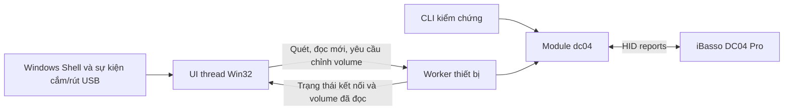

# iBasso DC04 Pro Tray — Thiết kế hệ thống

**Trạng thái** — Bản đề xuất để review trước khi triển khai  
**Nền tảng MVP** — Windows 11 x64, Rust stable

## 1. Mục tiêu

Một tiện ích chạy trong khay hệ thống để đọc và chỉnh **âm lượng do DC04 Pro báo qua HID**. Người dùng bấm icon tai nghe để mở popup. Thanh trượt chỉ hoạt động khi thiết bị đã trả về giá trị hợp lệ cho lần kết nối hiện tại. Trải nghiệm gồm tự nhận lại DAC khi cắm lại, hỗ trợ chuột và bàn phím, và tùy chọn chạy khi đăng nhập Windows.

Bản web iBasso trong workspace từng nhận DC04 Pro với FPGA `1.58` và hiển thị volume `50`. Windows từng ghi nhận USB VID `262A`, PID `187F`. `MI_01` trong ghi chép là interface audio. Collection HID, loại report, dải giá trị, bước chỉnh và hành vi của nút vật lý sẽ được xác minh ở giai đoạn CLI. [Kiểm tra bản web local](../README-local.md) · [Ghi chép nghiên cứu thiết bị](../research/dc04pro-software-research.md)

## 2. Kiến trúc



| Thành phần | Công nghệ | Trách nhiệm |
| --- | --- | --- |
| Build | Rust stable, Cargo, MSVC x64 | Một package chứa thư viện dùng chung, app tray và CLI |
| UI thread | `windows` crate, Win32 message loop | Nhận sự kiện Windows, quản lý icon và popup, gửi yêu cầu cho worker. Dùng `PostMessageW` làm tín hiệu để lấy snapshot mới từ worker |
| Worker | `std::thread` và đồng bộ từ thư viện chuẩn | Sở hữu HID handle, chạy từng giao dịch một, quản lý vòng đời kết nối và phát snapshot cho UI |
| Giao tiếp DAC | `hidapi` qua Windows HID | Liệt kê thiết bị, mở collection theo path, đọc/gửi report đúng theo giao thức đã xác minh |
| CLI | Binary console dùng module DAC chung | In thông tin thiết bị, đọc volume và hỗ trợ kiểm chứng một nấc ghi kèm đọc lại |

Chọn một package để CLI và app tray dùng chung cách nhận diện thiết bị và giải mã report ngay từ lần thử đầu tiên. CLI gọi trực tiếp module `dc04`. Worker và Win32 chỉ phục vụ app tray. [Bố cục package Cargo](https://doc.rust-lang.org/cargo/guide/project-layout.html) · [windows-rs](https://github.com/microsoft/windows-rs/blob/master/docs/crates/windows.md) · [hidapi-rs](https://github.com/ruabmbua/hidapi-rs)

## 3. Kết nối và trạng thái

1. App tạo cửa sổ Win32 ẩn, đăng ký nhận `WM_DEVICECHANGE` cho lớp HID rồi yêu cầu worker quét thiết bị. Nếu DAC đã cắm từ trước, lần quét đầu cũng đi theo luồng này. [Microsoft · Device notifications](https://learn.microsoft.com/en-us/windows/win32/devio/registering-for-device-notification)
2. Worker lọc VID/PID, xác nhận usage page/usage của collection đã kiểm chứng và mở theo path. Nếu có nhiều ứng viên hợp lệ mà chưa phân biệt được, hiển thị yêu cầu chỉ cắm một DC04 Pro.
3. Worker tạo một phiên kết nối mới, đọc **volume hiện tại** và kiểm tra report trước khi báo sẵn sàng. Một giao dịch đọc có thể cần gửi yêu cầu cho DAC rồi nhận phản hồi. Cách gửi/nhận cụ thể sẽ lấy từ kết quả CLI. [Microsoft · Obtaining HID reports](https://learn.microsoft.com/en-us/windows-hardware/drivers/hid/obtaining-hid-reports)
4. Khi thiết bị bị rút hoặc I/O xác nhận mất kết nối, worker đóng handle, xóa yêu cầu chỉnh còn chờ và vô hiệu hóa phiên. Phiên sau luôn đọc lại từ DAC trước khi mở khóa slider. Nếu event đến trước lúc thiết bị sẵn sàng, worker thử quét lại vài lần trong thời gian giới hạn.

| Trạng thái | Popup |
| --- | --- |
| Chưa thấy DAC | Hiện “Chưa cắm DAC”, slider bị khóa |
| Đang kết nối hoặc đọc lần đầu | Hiện “Đang đọc âm lượng…”, slider bị khóa |
| Đã đọc thành công | Hiện nấc đã xác nhận và mở khóa slider |
| Lỗi mở hoặc đọc | Hiện trạng thái lỗi phù hợp và nút “Thử lại”, slider bị khóa nếu chưa xác nhận được giá trị hiện tại |

### Luồng chỉnh âm lượng

- Mỗi yêu cầu mang mã phiên và nấc người dùng chọn. Worker chỉ xử lý yêu cầu thuộc phiên hiện tại. UI chỉ dùng snapshot thuộc phiên mới nhất.
- Khi kéo, UI hiển thị nấc đang chọn. Worker giữ **một giá trị mới nhất** đang chờ và chỉ có một giao dịch HID đang chạy. Nhả chuột gửi mức cuối cùng qua cùng cơ chế. Phản hồi cũ có thể cập nhật mức đã xác nhận, còn số đang kéo lấy theo thao tác mới nhất.
- Sau lệnh ghi, worker đọc lại để chốt theo mức DAC trả về. Nếu timeout, trạng thái chuyển sang cần đồng bộ lại và yêu cầu đang chờ được xóa. Worker đọc mới để biết DAC đã áp dụng mức nào. Người dùng có thể chỉnh tiếp sau khi đã đồng bộ.
- Khi mở popup, worker đọc mới. Nếu DAC phát thông báo khi bấm nút vật lý, dùng thông báo để cập nhật. Nếu chỉ đọc được theo yêu cầu, đọc định kỳ lúc popup mở và ưu tiên giao dịch chỉnh đang chờ. Nhịp đọc/chỉnh sẽ chọn từ phép đo CLI.
- UI thread luôn tách khỏi lời gọi HID. Giai đoạn CLI cần kiểm tra thời hạn thực tế của cả đọc và ghi khi rút cáp. Nếu lời gọi bị treo, giải quyết transport trước khi áp dụng cơ chế reconnect của tray.

## 4. UI và tích hợp Windows

- **Tray** — Icon tai nghe và tooltip có mức volume đã xác nhận hoặc trạng thái kết nối. Bấm trái hoặc kích hoạt bằng bàn phím để mở popup. Khôi phục icon khi nhận `TaskbarCreated` sau khi Explorer khởi động lại. [Microsoft · Taskbar](https://learn.microsoft.com/en-us/windows/win32/shell/taskbar)
- **Popup** — Rộng khoảng 320 DIP, hiện tên DAC, trạng thái và trackbar Win32. Neo vào rect của icon bằng `Shell_NotifyIconGetRect`, căn theo vùng làm việc của màn hình. Theo sáng/tối Windows, dùng manifest Per-Monitor V2, kiểm tra DPI 100% và 150%. [Microsoft · Notification Area](https://learn.microsoft.com/en-us/windows/win32/shell/notification-area) · [Microsoft · High DPI](https://learn.microsoft.com/en-gb/windows/win32/hidpi/high-dpi-desktop-application-development-on-windows)
- **Tương tác** — Kéo slider, cuộn trên slider hoặc dùng phím mũi tên để chỉnh từng nấc. `Esc` hay bấm ra ngoài sẽ đóng popup. Dải slider lấy từ giao thức đã kiểm chứng.
- **Menu chuột phải** — “Khởi động cùng Windows” và “Thoát”. Khi người dùng bật tự khởi động, ghi đường dẫn tuyệt đối có dấu ngoặc kép vào khóa `HKCU\Software\Microsoft\Windows\CurrentVersion\Run`. Nếu di chuyển bản portable, bật lại tùy chọn ở đường dẫn mới. Dùng mutex theo phiên Windows để tránh mở hai app tray. [Microsoft · Run registry keys](https://learn.microsoft.com/en-us/windows/win32/setupapi/run-and-runonce-registry-keys)

## 5. Cấu trúc thư mục đề xuất

Đặt package Rust tại `tray/` để dễ phân biệt với bản web local đang dùng làm nguồn đối chiếu. Thêm từng phần theo mốc triển khai.

```text
D:\IbassoDC04Pro\
├── docs/
│   └── system-design.md          Bản thiết kế đang review
├── local-web/                    Bản web iBasso có sẵn
├── research/                     Ghi chép và ảnh kiểm chứng có sẵn
└── tray/                         Package Cargo dự kiến
    ├── Cargo.toml
    ├── Cargo.lock
    ├── build.rs                  Nhúng icon và manifest vào binary tray
    ├── assets/
    │   ├── tray.ico
    │   └── tray.manifest
    └── src/
        ├── lib.rs                Khai báo các module dùng cho hai binary
        ├── bin/
        │   ├── dc04-tray.rs      Điểm vào của app Windows
        │   └── dc04-cli.rs       Lệnh list, get và thử chỉnh một nấc
        ├── dc04/
        │   ├── mod.rs            Thao tác mở, đọc và chỉnh volume
        │   ├── hid.rs            Liệt kê collection, mở path, truyền report
        │   └── protocol.rs       Mã hóa/giải mã và kiểm tra dữ liệu volume
        ├── worker.rs             Kết nối, snapshot, phiên và xử lý yêu cầu
        └── win32/
            ├── mod.rs            Message loop, hotplug và vòng đời cửa sổ
            ├── tray.rs           Icon, tooltip và menu chuột phải
            ├── popup.rs          Trackbar, bố cục, bàn phím và DPI
            └── startup.rs        Tùy chọn chạy khi đăng nhập
```

Các quy tắc về report và giá trị hợp lệ nằm ở `dc04/protocol.rs`. `worker.rs` quyết định lúc nào đọc hoặc ghi. `win32/` xử lý vị trí cửa sổ, input và cách hiển thị snapshot.

## 6. Thứ tự triển khai và tiêu chí qua mốc

| Mốc | Việc làm | Tiêu chí qua mốc |
| --- | --- | --- |
| 1. CLI chỉ đọc | Đối chiếu luồng WebHID của hãng để tìm collection, report và kiểu phản hồi. Chạy thử trên DAC | Hai giá trị khác nhau được kiểm tra bằng nút vật lý và web app của hãng. CLI đọc đúng sau khi mở mới và sau khi rút/cắm lại, kể cả khi Windows đang dùng loa khác |
| 2. CLI ghi một nấc | Thử với mức thấp. Ghi một nấc, đọc lại bằng CLI mới và đối chiếu trạng thái thực của DAC. Ghi nhận timeout khi rút thiết bị | Xác nhận volume DAC thay đổi đúng một nấc. Xác định dải, bước, phản hồi và hành vi khi mất kết nối. Ghi lại dữ liệu kiểm chứng trong `research/` |
| 3. App tray | Gắn transport đã kiểm chứng vào worker và popup | Giao diện phản hồi khi kéo nhanh, chốt ở giá trị đọc lại cuối cùng, khóa khi rút cáp, mở lại với giá trị mới khi cắm lại và cập nhật được thay đổi do nút vật lý |
| 4. Đóng gói | Kiểm tra Explorer restart, sleep/resume, DPI khác nhau, web app mở song song và tùy chọn startup | Bản `.exe` portable chạy trên Windows 11 x64. Hành vi khi HID đang bị ứng dụng khác giữ được xác định và thể hiện đúng trên UI |

Nếu chỉ xác minh được đường đọc, kết quả giai đoạn CLI sẽ quyết định phạm vi bước tiếp theo. Một chế độ chỉnh Windows endpoint, nếu được chọn, sẽ có nhãn **Âm lượng Windows** và là một quyết định sản phẩm riêng. [Microsoft · EndpointVolume API](https://learn.microsoft.com/en-us/windows/win32/coreaudio/endpointvolume-api)
